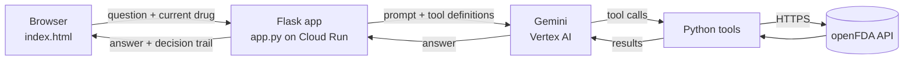

# FDA Drug AI Agent

A tool-calling AI agent that answers plain-English questions about medicines using live data from the FDA's public openFDA API: drug labels, reported side effects, recalls, approvals and interactions. Every answer comes with an **Agent decision trail** showing which tools the agent chose, what it searched for, and exactly what the FDA sent back.

**Stack:** Python, Flask, Gemini on Vertex AI (Google GenAI SDK), openFDA, Google Cloud Run.

> Not medical advice. Answers summarise public FDA records and can be incomplete or out of date.

---

## Why this is an agent, not just an API wrapper

There are no routing rules in the code. Nothing says "if the question mentions recalls, call the recalls endpoint". The model reads each question and decides for itself:

- **which** tools to call (one, several, or none),
- **what** to pass them (the drug name it extracted),
- and **how** to turn the results into an answer.

The decision trail makes those choices visible. Some examples from testing:

| Input | What the agent did |
|---|---|
| "Have there been any recalls?" (Lipitor selected) | Called the recalls tool only, for Lipitor |
| "What are the official warnings, and what side effects have people actually reported?" | Called two tools: label and adverse events |
| Just the word "Tylenol" | Decided on its own to call four tools at once |
| "Can I take it with grapefruit?" (Lipitor selected) | Called the interactions tool only, for Lipitor |
| "Is coffee bad for you?" | Called no tools and explained it only covers FDA-regulated drugs |

---

## Architecture



1. The browser sends the question plus the **current drug**, the only state carried between questions.
2. Flask passes the question to Gemini along with the five tool functions. The SDK turns each function's signature and docstring into a tool definition the model can see.
3. Gemini decides which tools to call. Each call is wrapped by a small `logged` decorator that records the tool name, arguments and result.
4. Flask returns the answer and the recorded calls, and the page renders them as the decision trail.

---

## The tools

| Tool | openFDA endpoint | Answers |
|---|---|---|
| `get_drug_label` | `/drug/label.json` | Uses, dosage, warnings, boxed warnings, contraindications |
| `get_adverse_events` | `/drug/event.json` | Most-reported side effects, with counts |
| `get_drug_recalls` | `/drug/enforcement.json` | Recall history: date, class, firm, reason |
| `get_drug_approvals` | `/drug/drugsfda.json` | Original approval date, sponsor, products and strengths |
| `get_drug_interactions` | `/drug/label.json` | Drugs, foods and drinks to avoid combining it with |

Each tool is a plain Python function in `tools/`. Its docstring tells the model when to use it.

---

## Design decisions

**Only the drug name is kept as state.** The model itself is stateless, so "memory" means resending context with each request. Resending the full conversation made a small model answer from earlier replies instead of calling tools. Now each question starts a fresh chat and carries only the current drug, so follow-ups like "any recalls?" still work, and every answer is grounded in a new tool call.

**The decision trail is logged at the tool, not read from model history.** Wrapping each tool in a `logged` decorator records exactly what ran, independently of what the SDK chooses to expose.

**Docstrings steer tool choice.** The label and interactions tools both read the drug label, so at first the agent answered grapefruit questions with the general label tool. One sentence in each docstring, telling the model which tool owns interaction questions, fixed it, with no routing code.

**Readable results first, raw JSON second.** The trail renders each tool's output in plain form (reaction bars, colour-coded recall classes, approval cards), with the raw FDA response one click away.

**Approvals favour the original brand.** Popular drugs have hundreds of generic approvals, so the approvals tool asks for brand-name (NDA) applications first, sorts single-ingredient and oldest approvals to the top, and removes duplicate product lines.

**Friendly failure.** If Gemini's rate limit is hit (HTTP 429), visitors see "please wait a minute" instead of a stack trace. Other errors return a generic message, and details stay in the server logs.

**Secrets stay out of the repo.** The openFDA API key lives in a local `.env` file (git-ignored) and as an environment variable on Cloud Run.

**Model choice.** Built on Gemini first because it was immediately available on Vertex AI. The tool layer is model-agnostic, and a move to Claude on Amazon Bedrock is planned.

---

## Known limitations

- **Misspellings can be silently "corrected".** In testing, "lbuterol" was searched as *levalbuterol*, a different drug. The decision trail exposes this, which is part of why it exists.
- **openFDA data is uneven.** Older drugs approved before modern records (levothyroxine, for example) may not show their original brand approval.
- **Speed and quotas.** A question can involve several model round trips. Heavy use can hit Vertex AI rate limits.

---

## Running locally

```bash
git clone https://github.com/david-carroll-aws/fda-drug-ai-agent.git
cd fda-drug-ai-agent
pip install -r requirements.txt
```

Create a `.env` file in the project root:

```
OPENFDA_API_KEY=your-openfda-key
```

A free key is available from [open.fda.gov](https://open.fda.gov/apis/authentication/). The app works without one, at a lower daily limit. You also need Google Cloud credentials with Vertex AI access (`gcloud auth application-default login`).

```bash
python app.py
```

Then open http://localhost:8080 (or whatever port app.py prints).

## Deploying to Cloud Run

```bash
gcloud run deploy fda-drug-ai-agent --source . --region us-east1 \
  --allow-unauthenticated --set-env-vars OPENFDA_API_KEY=your-openfda-key
```

---

## Roadmap

- Switch the model to Claude on Amazon Bedrock
- Ask the user to confirm misspelt drug names instead of guessing
- Stream the decision trail live as each tool runs
- Auto-deploy to Cloud Run from GitHub Actions
- Move the API key to Google Secret Manager

## Data source

All drug data comes from [openFDA](https://open.fda.gov/), a public service of the U.S. Food and Drug Administration. This project is not affiliated with or endorsed by the FDA.

## Licence

MIT
